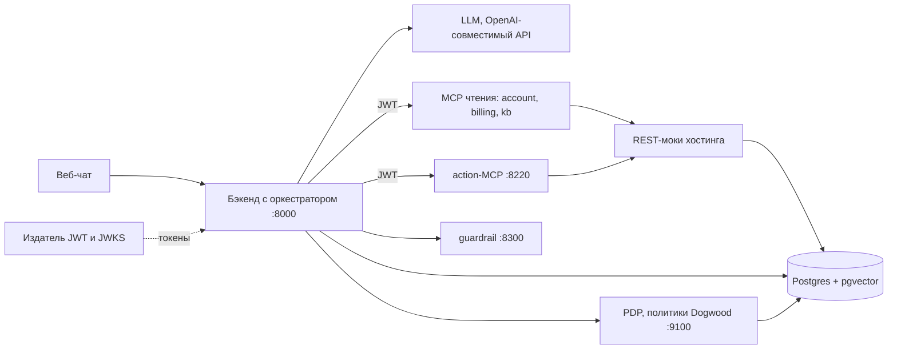

# Архитектура

Целевая схема со встречи 1. Код появляется по встречам: ядро стенда, оркестратор, действия, права,
дообученный маршрутизатор.

Стенд (`make stand`, :8100) несет издателя токенов, MCP-серверы чтения, REST-моки аккаунта,
биллинга и тикетов, базу знаний, веб-чат и страницу инженера поддержки.

## Кто решает

| Решение | Кто | Почему |
| --- | --- | --- |
| Каких агентов звать | модель (планировщик) | намерение заранее неизвестно |
| Пропустить ли шаг плана | код (гейт) | агент чтения не может нести действие |
| Какие инструменты видит агент | код (барьер 1) | права из токена |
| Можно ли этот вызов | код (барьер 2) и сервер | субъект только из токена |
| Цена до и после, правила | биллинг | владелец данных |
| «Да» относится к карточке? | код | согласие привязано к карточке |
| Подтверждение, лимит сессии | политика (PDP) | история вызовов |
| Похож ли текст на атаку | guardrail | вероятность, только флаг |
| Формулировка ответа | модель (редактор) | работа с языком |

## Где живет состояние

| | Что | Где |
| --- | --- | --- |
| Сессия | история планировщика, токены, карточки | память бэкенда, карточки – таблица `pending_cards` |
| Ключи | ключ идемпотентности и результат | `idempotency` и биллинг |
| Журналы | действия, вызовы модели и инструментов | `audit_log`, `llm_calls`, `tool_calls` |
| Решения политики | разрешения и отказы с причиной | `policy_events` |
| Данные хостинга | аккаунты, серверы, списания, тикеты | таблицы моков |
